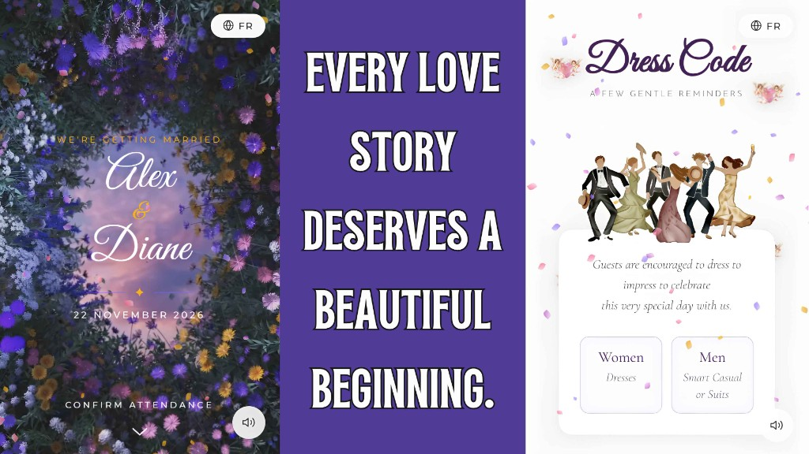

# Alex & Diane

### 22 November 2026 · Paris

A wedding invitation you do not open with your hands. You scroll it.



Three rooms, one evening.

**A garden at dusk.** Wildflowers frame the names. Gold type says they are getting married. A globe waits in the corner if you would rather read it in French.

**A violet vow.** *Every love story deserves a beautiful beginning.* The sentence is the whole middle of the card: loud, generous, impossible to miss.

**A dress code with confetti already in the air.** Guests in gowns and suits, a reminder to dress for the day, and two quiet boxes: dresses, or smart casual and suits.

Keep going and the rest of the night unfolds: the story, the program, the gifts, the mairie on the map, a place to stay, and a song that starts when you tap the seal.

The last room is the RSVP. A name, a meal, the people coming with them, a note for the couple. Those lines are written for a **Google Sheet**, the guest book you can open on a phone the week before the wedding. The page confirms each reply on screen until that sheet is connected.

---

## Open the envelope

```bash
npm install
npm run dev
```

Visit [http://localhost:3000](http://localhost:3000). The front door sends you straight to `/weddinginvitation.html`.

When it is time to send it into the world:

```bash
npm run build
npm start
```

---

## What is inside the box

| | |
|---|---|
| `public/weddinginvitation.html` | The invitation itself. Layout, motion, English and French, the form, the music. |
| `public/assests/` | Film, cover still, icons, and the day-program background. The folder is spelled `assests` on purpose, so the paths in the page keep working. |
| `public/favicon.svg` | The small purple star in the browser tab. |
| `app/page.tsx` | The redirect from `/` to the invitation. |
| `app/layout.tsx` | Title, description, and icon for the app shell. |
| `docs/alex-and-diane.jpg` | The portrait at the top of this page. |

Change the design in `weddinginvitation.html` and refresh. New pictures and clips go in `public/assests/`, then into the matching `src` or `<source>`.

---

## How it is built

Next.js keeps the lights on: the route, the server, the metadata. The invitation is a single document of HTML, CSS, and vanilla JavaScript. It is meant to feel handwritten, then hosted like a modern site. **Google Sheets** is the guest book behind the RSVP.

It will run anywhere Node can run Next: [Vercel](https://vercel.com), [Netlify](https://www.netlify.com/), or a server of your own. The videos are the heavy guests. Compress them before you upload if the host has a size limit.

---

Made with care for one date.

**Alex & Diane · 22 November 2026**
